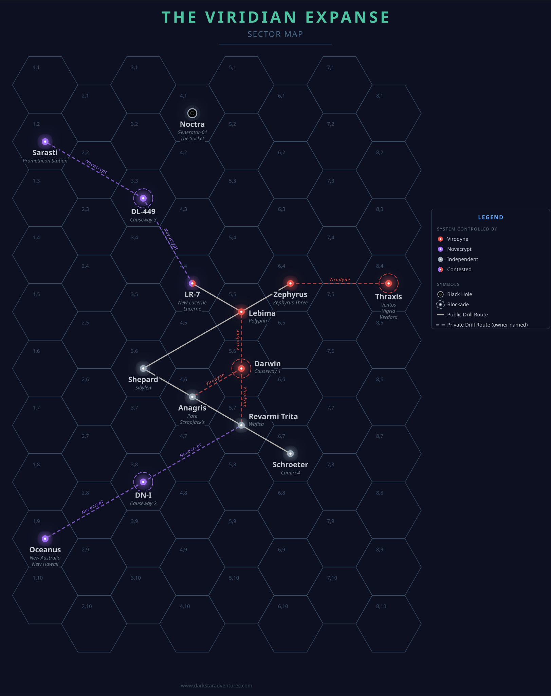

*Click the map to open it full size in a new tab. It is a vector image, so you can zoom in as far as you like.*

Known worlds and stations include the Schroeter system's [[Camiri 4]] (gang territory, and the campaign's starting location); the Revarmi Trita system's [[Wafisa]] (a dead-feeling megacity rich in alien artifacts), [[Blackharbor]] (a coastal settlement ruled by the [[Guardians of the Great Work]]), [[Port Ascension]] (an empty spaceport), and [[Mistretta 4]] ([[Dr. Elara Voss|Voss]]'s Omnitek base); the Lebima system's [[Polyphn]] (a night world and Omnitek headquarters); the Shepard system's [[Sibylen]] (site of major alien ruins) and its port city [[The Spigot]]; the Anagris system's [[Scrapjacks]] (a fuel depot and site of a cultist attack) and the nearby world of [[Pare]]; and the Thraxis system's [[Ventos]] (jungle world and site of the Red Rice Wars).

The crew's route across Season 1 ran from Camiri 4 to Wafisa, to Blackharbor and back to Wafisa, then to Scrapjacks, to Sibylen and The Spigot, and onward toward further destinations.

Thorne's family runs Draxus Goods, a shipping company based on his home world of Zephyrus Three.

---
*Appears in: Ep 1-29*
